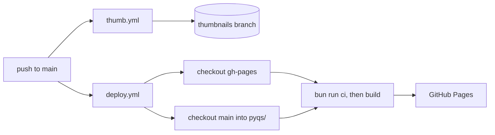

# Deployment

GitHub Pages hosts the site. The workflows live on the `main` branch in `.github/workflows/`, because each push of new papers should rebuild the site.

## deploy.yml

The workflow runs on every push to `main` and on manual runs from the Actions tab.

1. Check out `gh-pages` (the site) at the root, and `main` (the papers) into `pyqs/`.
2. Install dependencies with Bun and restore the build cache.
3. Run `bun run ci`: lint, tests and type checks. A failure stops the deploy.
4. Build with `bun run --bun build`.
5. Upload `dist/` and deploy it to GitHub Pages.

Pushes to `gh-pages` don't start a deploy. After changing the site, run the workflow manually or push to `main`.

## thumb.yml

The workflow keeps the `thumbnails` branch in sync with the PDFs on `main`. It runs when a push changes a PDF, and on manual runs.

The logic lives in `.github/scripts/sync-thumbnails.sh`. It compares state instead of diffs, so any run fixes what earlier runs missed:

1. It reads each PDF's path and git blob id from the index. The blob id changes when the file's content changes.
2. It compares them with `.manifest.tsv` on the `thumbnails` branch, which lists what the last run rendered.
3. It renders PDFs that are new, changed or missing a thumbnail with `pdftoppm` and `cwebp`, one per CPU at a time.
4. It deletes thumbnails whose PDF no longer exists.

The checkout has no file contents and only `.github/` in the working tree. The script adds just the PDFs it renders, so a run downloads those files instead of the whole 1.2 GB of PDFs.

The `thumbnails` branch keeps a single commit that the workflow replaces on each run. PDFs that fail to render show as warnings, and the run fails after pushing the other thumbnails. To render everything again, start a manual run with "Render every thumbnail again" checked.

## Incremental builds

`experimental.incrementalBuild` in `astro.config.mjs` lets a build copy unchanged pages from the previous build instead of rendering them again.

Astro reuses a page when both of these match the previous build:

- the page's `cacheKey`, which `[...slug].astro` sets to the entry's digest from the loader;
- a hash of the route's code, including every component and stylesheet it imports.

Adding a paper re-renders its page and its folder's page. A code change re-renders every page that uses that code, and a change to `astro.config.mjs` or `bun.lock` re-renders everything.

The cache lives in `cache/astro/`. CI restores it with a key that changes on every run and falls back to the most recent cache, so each build saves a fresh copy. To ignore the cache, run `bun run astro build --force`.

Two things on each page change without a code or content change: the build time and the social links in the footer. The `/build-info.json` endpoint has no `cacheKey`, so every build regenerates it, and a footer script loads it to show current values.

## Configuration

`src/configs/site.config.ts` holds the site title, header and footer links, the GitHub repository and the branches for PDFs and thumbnails. `astro.config.mjs` sets the domain (`https://haldwani.gehu.in`) and the `/pyqs/` base path.

The build fetches the social links from [mglsj/socials](https://github.com/mglsj/socials). If that fetch fails, the footer shows no social links.
